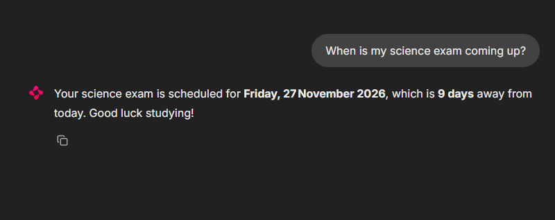
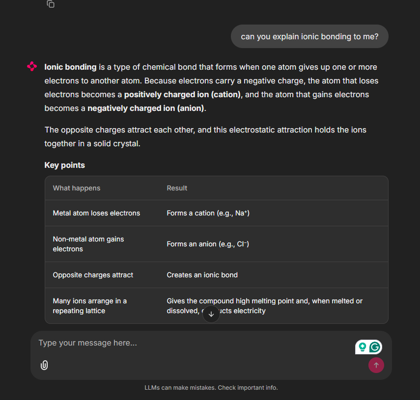

# Study-Agent-with-Chainlit
An AI powered studednt assistant built with Python, LangChain, Groq, and Chainlit. Features conversational learning, Wikipedia-powered topic research, and exam date tracking to help students study smarter.


Study Buddy combines conversational AI with custom tools to provide educational explanations, retrieve information, and track upcoming examinations.

## 🖥️ Demo

### Exam Tracking
Ask Study Buddy about an upcoming examination, and it retrieves the scheduled date and calculates how many days are remaining.



### AI-Powered Learning
Ask Study Buddy to explain an academic concept and receive structured explanations, key points, and easy-to-understand tables.



## ✨ Features

- **AI-Powered Conversations:** Ask academic questions and receive clear, student-friendly explanations.
- **Wikipedia Integration:** Retrieves external information through Wikipedia to help explain educational topics.
- **Exam Date Tracking:** Provides scheduled examination dates and calculates the remaining days.
- **Conversational Memory:** Maintains conversation history throughout the session.
- **AI Agent & Tool Calling:** Uses LangChain agents to determine which tools are needed to answer student queries.
- **Formatted Responses:** Supports structured explanations, bullet points, and tables.

## 🛠️ Tech Stack

| Technology | Purpose |
|---|---|
| Python | Core programming language |
| LangChain | Agent creation and tool orchestration |
| Groq | LLM inference |
| ChatGroq | Integration between LangChain and Groq |
| Chainlit | Interactive chatbot interface |
| Wikipedia API | External educational information |

## ⚙️ How It Works

Study Buddy uses a LangChain agent powered by Groq's language models.

The agent has access to two custom tools:

### 1. Wikipedia Search
The `wikipedia_search` tool retrieves information from Wikipedia when students ask questions about academic topics.

### 2. Exam Information
The `get_exam_info` tool retrieves the examination date for a particular subject and calculates the number of days remaining.

The agent determines which tool to use based on the student's query and generates a response using the available information.

```
